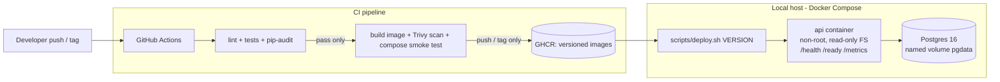

# Apex Operations API

[](https://github.com/the7ag/apex-ops-api/actions/workflows/ci.yml)

A small FastAPI service with PostgreSQL, packaged in Docker, deployed locally with
Docker Compose, and released through a GitHub Actions pipeline with versioned images
and a scripted rollback.

## Architecture



## Prerequisites
- Docker Desktop (with Compose v2)
- Git Bash (Windows) or any bash shell, plus `curl`
- Python 3.12+ (only for running tests outside Docker)

## Quick start
```bash
git clone <your-repo-url> apex-ops-api && cd apex-ops-api
cp .env.example .env               # then edit POSTGRES_PASSWORD
docker compose up -d --build
curl http://localhost:8000/health   # {"status":"ok"}
curl http://localhost:8000/ready    # {"status":"ready","db":"up"}
```
API docs (Swagger UI): http://localhost:8000/docs

## Endpoints
| Method | Path | Purpose |
|---|---|---|
| GET | `/health` | Liveness: process is running |
| GET | `/ready` | Readiness: database reachable (503 if not) |
| GET | `/version` | Running release version |
| GET | `/metrics` | Prometheus metrics |
| GET/POST | `/items` | List / create synthetic operations items |
| GET | `/items/{id}` | Fetch one item |

## Running tests locally
```bash
python -m venv .venv
.venv/Scripts/activate        # Windows (Git Bash: source .venv/Scripts/activate)
pip install -r requirements-dev.txt
ruff check .
pytest
RUN_INTENTIONAL_FAILURE=1 pytest   # shows the intentional failing test
```

## Automated checks
**Tests (`pytest`):** 10 tests + 1 intentional failure.

| # | Test | Proves |
|---|---|---|
| 1 | `test_health_returns_ok` | Liveness endpoint works |
| 2 | `test_ready_when_database_reachable` | Readiness reports DB up |
| 3 | `test_ready_returns_503_when_database_down` | Readiness fails correctly when the DB is unreachable |
| 4 | `test_create_item` | Create works, returns 201 |
| 5 | `test_create_item_rejects_invalid_input` | Input validation (422) |
| 6 | `test_list_items_returns_created_items` | Data is stored and listed |
| 7 | `test_get_missing_item_returns_404` | Correct not-found handling |
| 8 | `test_version_comes_from_environment` | Version is config, not code |
| 9 | `test_request_id_is_echoed` | Request tracing for log correlation |
| 10 | `test_metrics_endpoint_exposed` | Prometheus metrics available |
| 11 | `test_intentional_failure` | **Fails on purpose** (`RUN_INTENTIONAL_FAILURE=1`) to prove CI blocks a release |

**CI pipeline checks** ([`.github/workflows/ci.yml`](.github/workflows/ci.yml)): ruff lint → pytest →
pip-audit → Docker build → Trivy image scan → non-root check → Docker Compose smoke test against real
Postgres → push the versioned image to GHCR. Any failure stops everything after it, so nothing is released.

## Releasing and rolling back
**Release (CI):** push a tag. CI publishes `ghcr.io/the7ag/apex-ops-api:<version>`.
```bash
git tag v1.1.0 && git push origin v1.1.0
```
Every other push to `main` publishes `ghcr.io/the7ag/apex-ops-api:sha-<commit>`.

**Deploy / roll back (local host):**
```bash
APP_VERSION=1.0.0 docker compose build api   # or pull the image from GHCR
scripts/deploy.sh 1.0.0                      # waits for /ready, auto-rolls back on failure
APP_VERSION=1.1.0 docker compose build api
scripts/deploy.sh 1.1.0
scripts/rollback.sh                          # back to 1.0.0
```
See [docs/RUNBOOK.md](docs/RUNBOOK.md) for the full procedures.

## Evidence
All demos can be re-run with `bash scripts/demo.sh release | auto-rollback | db-outage`.

| What | Evidence |
|---|---|
| CI green (lint, tests, audit, build, scan, smoke test, push) | [ci-green.png](docs/evidence/ci-green.png) · [Actions history](https://github.com/the7ag/apex-ops-api/actions) |
| CI blocked a real failure (release job skipped) | [ci-failed-real.png](docs/evidence/ci-failed-real.png) |
| CI blocked the intentional failure | [ci-blocked.png](docs/evidence/ci-blocked.png) |
| Release `v1.0.0` published to GHCR | [Release run](https://github.com/the7ag/apex-ops-api/actions/runs/40780548810) |
| Deploy 1.0.0 → 1.1.0 → rollback, data persisted | [release-rollback.log](docs/evidence/release-rollback.log) |
| Broken 1.2.0 → automatic rollback to 1.1.0 | [auto-rollback.log](docs/evidence/auto-rollback.log) |
| DB outage investigation and recovery | [db-outage.log](docs/evidence/db-outage.log) · [write-up](docs/RUNBOOK.md#5-failure-investigation-demonstrated-database-outage) |

## Documentation
- [Runbook](docs/RUNBOOK.md): deploy, rollback, incident response, troubleshooting, monitoring and alerts
- [Security](docs/SECURITY.md): secrets, least privilege, scanning, cost-aware cloud path
- [Decision memo](docs/DECISION_MEMO.md): decisions, trade-offs, assumptions, risks, improvements
- [AI disclosure](AI_DISCLOSURE.md)

## Repository map
| Path | What it is |
|---|---|
| `app/` | Application source |
| `tests/` | Automated tests |
| `Dockerfile` | Multi-stage, non-root image |
| `docker-compose.yml` | API + Postgres + persistent volume |
| `.github/workflows/ci.yml` | CI/CD pipeline |
| `scripts/` | Deploy, rollback and demo scripts |
| `docs/` | Runbook, security notes, decision memo, evidence |
| `AI_DISCLOSURE.md` | How AI assistance was used |

## Assumptions
- A local Docker host stands in for a production server; "deploying" means running a specific image version on it.
- All data is synthetic (simple operations items); no real or personal data.
- A few seconds of downtime during a deploy is acceptable at this scale.
- No paid cloud resources are used; the cloud path is a proposal ([SECURITY.md](docs/SECURITY.md#cost-aware-path-to-cloud-hosting)).

Full trade-offs and known gaps: [docs/DECISION_MEMO.md](docs/DECISION_MEMO.md).
