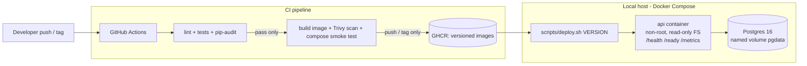

# Apex Operations API

A small FastAPI service with PostgreSQL, packaged in Docker, deployed locally with
Docker Compose, and released through a GitHub Actions pipeline with versioned images
and a scripted rollback.

## Architecture



## Prerequisites
- Docker Desktop (with Compose v2)
- Git Bash (Windows) or any bash shell, plus `curl`
- Python 3.12+ (only for running tests outside Docker)

## Quick start
```bash
git clone <your-repo-url> apex-ops-api && cd apex-ops-api
cp .env.example .env               # then edit POSTGRES_PASSWORD
docker compose up -d --build
curl http://localhost:8000/health   # {"status":"ok"}
curl http://localhost:8000/ready    # {"status":"ready","db":"up"}
```
API docs (Swagger UI): http://localhost:8000/docs

## Endpoints
| Method | Path | Purpose |
|---|---|---|
| GET | `/health` | Liveness: process is running |
| GET | `/ready` | Readiness: database reachable (503 if not) |
| GET | `/version` | Running release version |
| GET | `/metrics` | Prometheus metrics |
| GET/POST | `/items` | List / create synthetic operations items |
| GET | `/items/{id}` | Fetch one item |

## Running tests locally
```bash
python -m venv .venv
.venv/Scripts/activate        # Windows (Git Bash: source .venv/Scripts/activate)
pip install -r requirements-dev.txt
ruff check .
pytest
RUN_INTENTIONAL_FAILURE=1 pytest   # shows the intentional failing test
```

## Releasing and rolling back (local)
```bash
APP_VERSION=1.0.0 docker compose build api   # build a versioned image
scripts/deploy.sh 1.0.0
APP_VERSION=1.1.0 docker compose build api
scripts/deploy.sh 1.1.0
scripts/rollback.sh                          # back to 1.0.0
```
See [docs/RUNBOOK.md](docs/RUNBOOK.md) for the full procedures.

## Repository map
| Path | What it is |
|---|---|
| `app/` | Application source |
| `tests/` | Automated tests |
| `Dockerfile` | Multi-stage, non-root image |
| `docker-compose.yml` | API + Postgres + persistent volume |
| `.github/workflows/ci.yml` | CI/CD pipeline |
| `scripts/` | Deploy and rollback scripts |
| `docs/` | Runbook, security notes, decision memo, evidence |
| `AI_DISCLOSURE.md` | How AI assistance was used |

## Assumptions
- TODO: list your assumptions (e.g. "local Docker host stands in for a production server").
